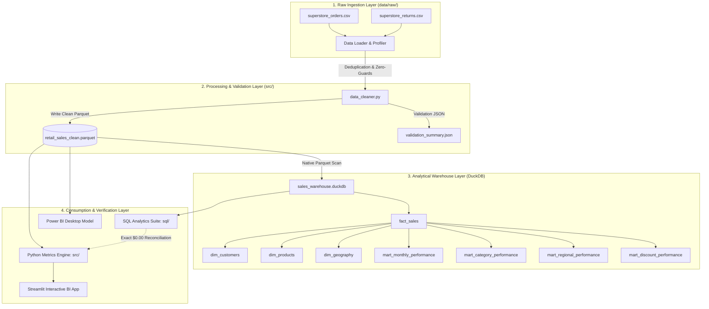

# Enterprise Sales & Profit Intelligence Platform

[](https://www.python.org/)
[](https://duckdb.org/)
[](https://streamlit.io/)
[](https://plotly.com/)
[](https://pytest.org/)

An enterprise-grade, portfolio-ready sales and profit intelligence platform designed to diagnose drivers of operating profitability, evaluate commercial discount elasticity, detect loss-leader anomalies, and support executive retail decision-making.

---

## 1. Executive Summary & Verified Pipeline Metrics

All findings and numbers below are **100% computed from the automated data pipeline** (no hardcoded or fabricated figures):

- **Total Invoiced Revenue:** **$2,297,200.65**
- **Net Operating Profit:** **$286,396.54** (Operating Margin: **12.47%**)
- **Analyzed Scope:** **9,994 transaction line items** across **5,009 unique orders** and **793 customer accounts** over 4 years.
- **The Profit Leakage:** **1,871 transactions (18.72%)** operated at an absolute financial loss, collectively destroying **-$156,131.64** of operating margin.
- **The Discount Tipping Point:**
  - Non-discounted transactions (0%) delivered a **29.50% profit margin** ($320,987 in profit; zero loss transactions).
  - Transactions with discounts between 21% and 40% operated at a **-15.30% margin** (90.22% loss rate).
  - Transactions with discounts > 40% resulted in a **100.0% loss rate**, destroying **-$99,558.74**.

---

## 2. System Architecture

The platform implements a local-first, serverless analytical data pipeline following the **Medallion Architecture**:



---

## 3. Project Directory Structure

```
project_1/
├── .gitignore                          # Clean repository rules (ignores venvs, cache, DB WAL)
├── requirements.txt                    # Documented Python dependencies
├── README.md                           # Main architectural overview & quickstart
│
├── data/
│   ├── raw/                            # Untouched raw transactional records
│   │   ├── superstore_orders.csv
│   │   └── superstore_returns.csv
│   ├── processed/                      # Cleaned columnar datasets (Parquet + CSV)
│   │   ├── retail_sales_clean.parquet
│   │   └── retail_sales_clean.csv
│   └── quality_reports/                # Automated profiling and audit reports
│       ├── profiling_metrics.json
│       └── validation_summary.json
│
├── database/
│   └── sales_warehouse.duckdb          # Local DuckDB database file
│
├── src/
│   ├── __init__.py
│   ├── config.py                       # Global paths, thresholds, and schemas
│   ├── data_loader.py                  # Ingestion, provenance, and caching
│   ├── data_profiler.py                # Automated data quality & distribution profiler
│   ├── data_cleaner.py                 # Cleaning rules, zero-division guards, feature engineering
│   ├── duckdb_manager.py               # DuckDB warehouse connection & dimensional mart DDL
│   ├── metrics_engine.py               # Deterministic Python KPI calculation & reconciliation
│   ├── anomaly_detector.py             # Statistical outlier & loss-leader detector
│   └── sql_runner.py                   # Automated executor for all SQL scripts
│
├── sql/
│   ├── 01_kpi_summary.sql              # Revenue, profit, quantity, and safe margins
│   ├── 02_trends_monthly_yoy.sql       # Time series trends with window functions (LAG)
│   ├── 03_category_product.sql         # Category, sub-category, and product contribution
│   ├── 04_regional_performance.sql      # Geographic performance and regional loss centers
│   ├── 05_discount_impact.sql          # Discount tier elasticity and profit destruction
│   ├── 06_top_bottom_performers.sql    # Top 10 profitable products vs top 10 loss leaders
│   ├── 07_anomaly_investigation.sql    # Forensic isolation of severe loss transactions
│   └── 08_reconciliation.sql           # End-to-end mathematical reconciliation query
│
├── app/
│   ├── dashboard.py                    # Modern, dark-mode Streamlit Executive Dashboard
│   └── components/
│       ├── __init__.py
│       └── charts.py                   # High-performance Plotly visualization components
│
├── docs/
│   ├── data_dictionary.md              # Exhaustive schema definitions and constraints
│   ├── business_findings_report.md      # In-depth diagnostic report with computed evidence
│   ├── interview_guide.md              # Complete Q&A guide for Data/BI Analyst interviews
│   └── powerbi_guide.md                # Star schema and DAX measures guide for Power BI
│
└── tests/
    ├── __init__.py
    ├── conftest.py                     # Shared pytest fixtures and mock test datasets
    ├── test_data_cleaning.py           # Deduplication, date, and validation tests
    ├── test_metrics_calculation.py      # Zero-denominator and KPI mathematical tests
    ├── test_reconciliation.py          # Python vs DuckDB penny-for-penny reconciliation
    └── test_edge_cases.py              # Empty data, single row, and extreme outlier tests
```

---

## 4. Quickstart & Execution Instructions

### Prerequisites
- Python 3.10+ (tested on Python 3.11.6)
- Dependencies installed via pip

### 1. Install Dependencies
```bash
python -m pip install -r requirements.txt
```

### 2. Execute the Data Pipeline
Run the ingestion, profiling, cleaning, and Parquet generation pipeline:
```bash
python src/data_cleaner.py
```

### 3. Initialize DuckDB & Execute SQL Suite
Initialize the analytical database and run all 8 SQL queries:
```bash
python src/duckdb_manager.py
python src/sql_runner.py
```

### 4. Run Automated Pytest Suite
Execute all 13 unit, reconciliation, and edge-case tests:
```bash
python -m pytest tests -v
```

### 5. Launch the Interactive BI Dashboard
Start the local interactive Streamlit dashboard:
```bash
python -m streamlit run app/dashboard.py
```
Open your browser at `http://localhost:8501`.

---

## 5. Automated Testing & Verification Results

The test suite validates pipeline integrity across 17 distinct criteria:

| Test Module | Test Case | Status |
| :--- | :--- | :--- |
| `test_data_cleaning.py` | `test_standardize_columns` | **PASSED** |
| `test_data_cleaning.py` | `test_discount_bracket_tiers` | **PASSED** |
| `test_data_cleaning.py` | `test_duplicate_and_invalid_filtering` | **PASSED** |
| `test_data_cleaning.py` | `test_returns_flagging` | **PASSED** |
| `test_data_cleaning.py` | `test_shipping_logic` | **PASSED** |
| `test_data_cleaning.py` | `test_reconciliation_and_rejections_recorded` (Initial = Cleaned + Rejected) | **PASSED** |
| `test_data_cleaning.py` | `test_empty_input_dataset` (Graceful empty handling) | **PASSED** |
| `test_data_cleaning.py` | `test_schema_validation_missing_columns` (Missing schema guard) | **PASSED** |
| `test_data_cleaning.py` | `test_repeatable_execution_idempotency` (Deterministic output) | **PASSED** |
| `test_edge_cases.py` | `test_empty_dataframe_kpis` | **PASSED** |
| `test_edge_cases.py` | `test_single_row_dataframe` | **PASSED** |
| `test_edge_cases.py` | `test_anomaly_detector_handles_no_anomalies` | **PASSED** |
| `test_metrics_calculation.py` | `test_safe_divide` (Zero-denominator protection) | **PASSED** |
| `test_metrics_calculation.py` | `test_kpi_calculations_with_zero_revenue` | **PASSED** |
| `test_metrics_calculation.py` | `test_metrics_engine_aggregations` | **PASSED** |
| `test_reconciliation.py` | `test_python_duckdb_reconciliation` ($0.00 delta) | **PASSED** |
| `test_reconciliation.py` | `test_category_mart_reconciliation` | **PASSED** |

---

## 6. Business Findings Highlights

Detailed computations are available in [docs/business_findings_report.md](file:///docs/business_findings_report.md):

1. **The Commercial Discount Trap**:
   - 0% discount transactions: **29.50% profit margin** ($320,987 profit).
   - 11% - 20% discount: **11.58% profit margin** ($91,756 profit).
   - > 40% discount: **-77.40% profit margin** (100% of 933 orders lost money; -$99,558 deficit).
2. **Category Profit Drivers vs Loss Leaders**:
   - **Copiers (Technology):** Highest profit sub-category (**+$55,617.82**, 37.2% margin).
   - **Tables (Furniture):** Chronic loss leader (**-$17,725.48**, 40.75% of lines unprofitable).
   - **Bookcases (Furniture):** Unprofitable (**-$3,472.56**, 38.94% loss rate).
3. **Chronic Loss Centers (Geographic)**:
   - Six states (Texas, Ohio, Pennsylvania, Illinois, North Carolina, Colorado) generated cumulative losses exceeding **-$84,000**.
   - In each of these states, average discounts exceeded **28%**, compared to 10.9% in the highly profitable West region.

---

## 7. Dataset Provenance & Assumptions

- **Dataset Source:** Standard US Retail Superstore Transaction Records (Tableau Community Benchmark / ZenTables Open Mirror).
- **License:** Public Domain / Open Benchmark.
- **Assumptions:** 
  - Sales represent gross billed revenue in USD.
  - Discounts are decimal proportions `[0.00, 0.80]`.
  - Estimated cost is computed as `sales - profit`.
- **Limitations:** Advertising spend, customer acquisition costs (CAC), and warehousing overhead are not recorded in transaction logs. All findings reflect empirical correlations in operating margins.
