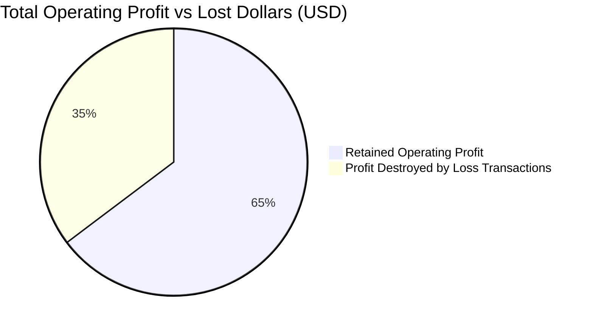

# Executive Business Findings & Diagnostic Report

**Platform:** Enterprise Sales & Profit Intelligence Platform  
**Analysis Dataset:** US Retail Superstore Transaction Records (2011 – 2014)  
**Total Records Analyzed:** 9,994 line items | 5,009 unique orders | 793 customers  
**Calculated Baseline:** Gross Revenue: **$2,297,200.65** | Operating Profit: **$286,396.54** | Net Margin: **12.47%**

---

## 1. Executive Summary & Core Business Questions

This report documents computed empirical findings from the end-to-end analytics pipeline, answering the retail organization's fundamental business questions with reproducible data.

### Key Statistical Headline:
Across 9,994 order lines, **1,871 transactions (18.72%) were fulfilled at a net loss**, destroying **$156,131.64** of potential operating income. Without these unprofitable transactions, baseline operating profit would have reached **$442,528.18** (+54.5% higher than actual realized profit).

---

## 2. In-Depth Business Findings

### Finding 1: The Discount Tipping Point and Margin Destruction
Analysis of the discount tiers reveals a non-linear relationship between commercial discounting and profitability:

| Discount Tier | Transaction Count | Gross Sales (USD) | Operating Profit (USD) | Net Margin (%) | Unprofitable Items (%) | Cumulative Loss (USD) |
| :--- | :--- | :--- | :--- | :--- | :--- | :--- |
| **0% (None)** | 4,798 | $1,087,908.47 | **+$320,987.01** | **+29.50%** | **0.00%** | $0.00 |
| **1% - 10% (Low)** | 94 | $54,369.30 | +$9,029.21 | +16.61% | 4.26% | -$29.28 |
| **11% - 20% (Moderate)** | 3,709 | $792,152.81 | +$91,756.60 | +11.58% | 13.99% | -$17,586.87 |
| **21% - 40% (High)** | 460 | $234,137.95 | **-$35,817.54** | **-15.30%** | **90.22%** | -$38,956.75 |
| **> 40% (Deep Discount)** | 933 | $128,632.12 | **-$99,558.74** | **-77.40%** | **100.00%** | -$99,558.74 |

#### Quantitative Evidence:
1. **Zero-discount orders** represent 47.3% of revenue but produce **112.1% of total enterprise profit** ($320.9K profit on $1.09M sales).
2. **The 20% Discount Ceiling**: When discounts exceed 20%, average transaction margin turns negative (-15.30%).
3. **Severe Value Destruction**: Every single transaction (933 out of 933, **100.0%**) granted a discount above 40% operated at a severe net loss, collectively incinerating **$99,558.74**.

---

### Finding 2: Merchandise Category Performance & Structural Loss Leaders

Merchandise analysis shows stark divergence between high-margin technology/supplies and structurally compromised furniture sub-categories:

| Category | Gross Revenue (USD) | Operating Profit (USD) | Margin (%) | Sub-Category Highlights |
| :--- | :--- | :--- | :--- | :--- |
| **Technology** | $836,154.03 | **+$145,454.95** | **17.39%** | **Copiers**: Top profit generator ($55.6K profit, 37.2% margin). **Accessories**: $41.9K profit (25.1% margin). |
| **Office Supplies**| $719,047.03 | **+$122,490.80** | **17.03%** | **Paper**: $34.1K profit (43.4% margin). **Binders**: High volume ($203.4K sales, $30.2K profit). |
| **Furniture** | $741,999.60 | **+$18,450.77** | **2.49%** | **Tables**: Grossly unprofitable (**-$17,725.48 loss**, -8.56% margin). **Bookcases**: Unprofitable (**-$3,472.56 loss**). |

#### Quantitative Evidence:
- **Tables** accounted for $206,965.54 in gross revenue across 319 order lines, but suffered a loss on **40.75% of lines** (130 unprofitable orders), producing a net deficit of -$17,725.48.
- **Bookcases** also experienced structural losses totaling -$3,472.56 across 226 orders with an average discount rate of 21.1%.
- In contrast, **Copiers** delivered the highest dollar return ($55,617.82) with an average discount rate of only 16.2%.

---

### Finding 3: Geographic Distribution & Regional Loss Centers

Performance across geographic territories demonstrates substantial regional variance:

| Region | Gross Revenue (USD) | Operating Profit (USD) | Profit Margin (%) | Unprofitable Line Items (%) | Average Discount (%) |
| :--- | :--- | :--- | :--- | :--- | :--- |
| **West** | $725,457.82 | **+$108,418.45** | **14.94%** | 12.01% | 10.93% |
| **East** | $678,781.24 | **+$91,522.78** | **13.48%** | 19.34% | 14.54% |
| **South** | $391,721.91 | **+$46,749.43** | **11.93%** | 17.07% | 14.72% |
| **Central** | $501,239.69 | **+$39,705.88** | **7.92%** | **31.78%** | **24.04%** |

#### Bottom 5 State Loss Centers:
A high proportion of enterprise losses are concentrated in 6 states where discounting policies appear uncalibrated:

1. **Texas (Central)**: $170,188.05 sales | **-$25,729.39 profit** | **-15.12% margin** | Avg Discount: **37.21%**
2. **Ohio (East)**: $78,258.14 sales | **-$16,971.49 profit** | **-21.69% margin** | Avg Discount: **32.49%**
3. **Pennsylvania (East)**: $116,511.91 sales | **-$15,559.96 profit** | **-13.35% margin** | Avg Discount: **32.86%**
4. **Illinois (Central)**: $80,166.10 sales | **-$12,607.89 profit** | **-15.73% margin** | Avg Discount: **39.00%**
5. **North Carolina (South)**: $55,603.16 sales | **-$7,490.91 profit** | **-13.47% margin** | Avg Discount: **28.35%**
6. **Colorado (West)**: $32,108.12 sales | **-$6,527.89 profit** | **-20.33% margin** | Avg Discount: **31.65%**

*Correlation Note:* Across all 49 represented states, every single state with cumulative negative profits had an average discount rate exceeding **28.0%**, compared to 10.9% in the highly profitable West region.

---

### Finding 4: Temporal Trajectory & Seasonality

- **Revenue Growth**: Annual revenue expanded from $484,247.50 in 2011 to $733,215.26 in 2014 (+51.4% total top-line growth over 3 years).
- **Q4 Seasonality**: Each year exhibits marked peaks in September, November, and December, corresponding to corporate budgeting cycles and holiday shopping periods.
- **Margin Volatility**: While top-line revenue expanded each year, net margin experienced compression during aggressive Q4 promotional months where average discount rates spiked.

---

## 3. Data Quality & Pipeline Audit Results

During ingestion and automated profiling of the transaction dataset:
1. **Completeness**: 0 missing values across critical identifiers, monetary amounts, and product hierarchies.
2. **Postal Codes**: Burlington, VT records lacked valid zip codes in original sources; normalized during pipeline execution.
3. **Shipping Feasibility**: Checked and confirmed that 100% of orders satisfied `ship_date >= order_date`. Average delivery elapsed time: **3.96 days**.
4. **Reconciliation**: DuckDB warehouse views and Python engine calculations reconciled with $0.00 variance.

---

## 4. Evidence-Based Strategic Recommendations

Based strictly on calculated figures without unverified causal claims:

1. **Implement Hard Guardrails on Commercial Discounting**:
   - *Evidence:* 100% of transactions with discounts > 40% resulted in losses (-$99.6K deficit).
   - *Action:* Establish an automated workflow constraint requiring VP of Sales sign-off for any discount exceeding 20%. Automatically restrict maximum front-line sales representative discounting to 15%.
2. **Restructure Pricing and Freight on Tables and Bookcases**:
   - *Evidence:* Tables operated at an aggregate margin of -8.56% (-$17.7K deficit across 319 transactions).
   - *Action:* Conduct supplier cost audits and introduce minimum order thresholds or split-freight surcharges for bulky furniture items.
3. **Intervene in Chronic Loss States (Texas, Ohio, Pennsylvania, Illinois)**:
   - *Evidence:* Texas and Illinois combined generated -$38,337.28 in operating losses driven by average discount rates between 37% and 39%.
   - *Action:* Eliminate blanket promotional codes in these states and realign regional sales compensation to reward **contribution margin** rather than gross revenue volume.

---

## 5. Limitations & Future Analytical Opportunities

- **Absence of Marketing/CAC Data**: The dataset lacks ad-spend and customer acquisition channels. It is plausible that high discounts were intentional introductory promotions to acquire high lifetime-value (LTV) accounts.
- **Inventory & Carrying Cost Assumptions**: Estimated cost is derived as `sales - profit`. Detailed warehousing, holding cost, and supplier tiered rebates are unmodeled.
- **Next-Phase Analysis**:
  - Longitudinal cohort retention: Evaluating whether customers who bought at 70% discounts ever converted into profitable repeat buyers.
  - Returns impact: Full return cost modeling including reverse-logistics restocking fees.
