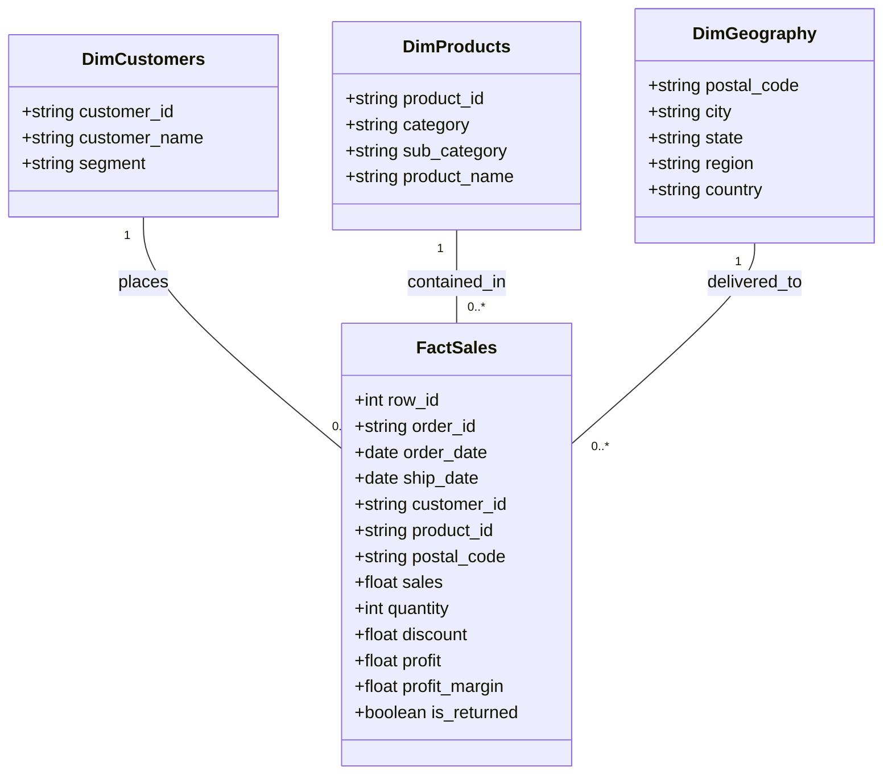

# Enterprise Data Dictionary

This document defines the schema, data types, business definitions, constraints, and lineage of all columns in the Enterprise Sales & Profit Intelligence Platform.

---

## 1. Cleaned Fact Table (`fact_sales`)

| Column Name | Physical Type | Logical Type | Nullable | Description / Business Logic | Example Values |
| :--- | :--- | :--- | :--- | :--- | :--- |
| `row_id` | `INTEGER` | Surrogate Key | No | Unique identifier for each line item within a transaction. | `1`, `42` |
| `order_id` | `VARCHAR` | Business Key | No | Standardized order identifier formatted as `[Country]-[Year]-[ID]`. Multiple rows share the same `order_id` for multi-item baskets. | `CA-2013-152156` |
| `order_date` | `DATE` | Temporal | No | Calendar date when the order was placed by the customer. | `2013-11-09` |
| `ship_date` | `DATE` | Temporal | No | Calendar date when the order was dispatched from fulfillment center. Verified: `ship_date >= order_date`. | `2013-11-12` |
| `ship_mode` | `VARCHAR` | Dimension | No | Service tier chosen for freight delivery. Values: `Standard Class`, `Second Class`, `First Class`, `Same Day`. | `Standard Class` |
| `customer_id` | `VARCHAR` | Foreign Key | No | Unique alphanumeric customer account identifier. | `CG-12520` |
| `customer_name` | `VARCHAR` | Dimension | No | Full legal/commercial name of customer contact. | `Claire Gute` |
| `segment` | `VARCHAR` | Dimension | No | Customer classification tier: `Consumer`, `Corporate`, `Home Office`. | `Consumer` |
| `country` | `VARCHAR` | Dimension | No | Operating sovereign nation. Fixed to `United States`. | `United States` |
| `city` | `VARCHAR` | Dimension | No | Municipality of destination address. | `Henderson`, `Seattle` |
| `state` | `VARCHAR` | Dimension | No | US State of delivery. | `Kentucky`, `California` |
| `postal_code` | `VARCHAR(5)`| Dimension | No | 5-digit US ZIP Code, formatted with leading zeros. | `42420`, `02138` |
| `region` | `VARCHAR` | Dimension | No | Geographic sales territory: `West`, `East`, `Central`, `South`. | `South` |
| `product_id` | `VARCHAR` | Foreign Key | No | Alphanumeric SKU identifier formatted as `[Category]-[SubCat]-[SKU]`. | `FUR-BO-10001798` |
| `category` | `VARCHAR` | Hierarchy L1 | No | High-level merchandise category: `Furniture`, `Office Supplies`, `Technology`. | `Furniture` |
| `sub_category` | `VARCHAR` | Hierarchy L2 | No | Detailed merchandise category (17 distinct values): `Chairs`, `Binders`, `Copiers`, etc. | `Bookcases` |
| `product_name` | `VARCHAR` | Dimension | No | Commercial catalog title of the product item. | `Bush Somerset Collection Bookcase` |
| `sales` | `DOUBLE` | Measure | No | Gross invoiced revenue in USD (after discount deduction). Range: `$0.44` to `$22,638.48`. | `261.96` |
| `quantity` | `INTEGER` | Measure | No | Physical unit count purchased. Must be an integer `>= 1`. Range: `1` to `14`. | `2` |
| `discount` | `DOUBLE` | Measure | No | Commercial discount percentage granted as a decimal fraction `[0.00, 0.80]`. | `0.00`, `0.20`, `0.80` |
| `profit` | `DOUBLE` | Measure | No | Net operating contribution profit in USD per line item (`sales - cost`). Can be negative. | `41.91`, `-3839.99` |
| `unit_price` | `DOUBLE` | Calculated | No | Implied gross revenue per unit: `ROUND(sales / quantity, 2)`. | `130.98` |
| `estimated_cost`| `DOUBLE` | Calculated | No | Operating cost of goods and fulfillment: `ROUND(sales - profit, 2)`. | `220.05` |
| `profit_margin` | `DOUBLE` | Calculated | No | Safe operating ratio: `CASE WHEN sales > 0 THEN profit / sales ELSE 0.0 END`. | `0.1600` |
| `discount_bracket`| `VARCHAR` | Calculated | No | Analytical tier: `0% (None)`, `1% - 10% (Low)`, `11% - 20% (Moderate)`, `21% - 40% (High)`, `> 40% (Deep Discount)`. | `0% (None)` |
| `shipping_days` | `INTEGER` | Calculated | No | Elapsed fulfillment duration: `ship_date - order_date`. | `3` |
| `is_returned` | `BOOLEAN` | Dimension | No | Boolean flag indicating whether the order was returned by customer (`True` / `False`). | `False` |

---

## 2. Dimensional Entity-Relationship Summary

---

## 3. Data Cleaning Rules & Rationale

| Field / Domain | Cleaning Rule Applied | Business & Technical Rationale | Rejection / Action Taken |
| :--- | :--- | :--- | :--- |
| **Row Level** | Exact row deduplication check across all original columns. | Redundant records inflate gross revenue, orders, and distortion metrics. | Dropped from clean table; written to `rejected_records.csv` with reason `EXACT_DUPLICATE_ROW`. |
| **Column Names** | Headers standardized to lower `snake_case` (e.g. `Order ID` -> `order_id`). | Eliminates whitespace and casing anomalies across SQL dialects and Python engines. | Cleaned in memory. |
| **Dates** | `order_date` and `ship_date` parsed using ISO/common datetime formats with `errors="coerce"`. | Prevents unparseable strings from breaking time series and window calculations. | Records with NaT are written to `rejected_records.csv` with reason `INVALID_UNPARSEABLE_DATE`. |
| **Temporal Integrity** | `ship_date >= order_date`. If `ship_date < order_date`, aligned to `order_date`. | Freight delivery cannot precede initial customer basket checkout. | Logged and adjusted to `order_date` (no customer record dropped). |
| **Monetary Sales** | `sales >= 0.0`. Negative gross sales rejected. | Negative billing belongs in credit memos or refunds, not gross demand logs. | Written to `rejected_records.csv` with reason `NEGATIVE_SALES`. |
| **Order Quantity** | `quantity >= 1` integer. | Zero or negative quantities represent corrupted line records. | Written to `rejected_records.csv` with reason `INVALID_QUANTITY`. |
| **Commercial Discount** | `0.0 <= discount <= 1.0`. | Discount is a bounded decimal fraction representing 0% to 100%. | Written to `rejected_records.csv` with reason `INVALID_DISCOUNT_OUT_OF_BOUNDS`. |
| **Postal Code** | Cleaned of floating point suffixes (`.0`) and padded with leading zeros to 5 digits. | Preserves East Coast US ZIP codes (e.g., `01234` instead of `1234`). | Sanitized string. |
| **Strings & Text** | Trimming leading/trailing whitespace across all text columns. | Prevents split dimensions in categorical group-by operations (e.g., `'Consumer'` vs `'Consumer '`). | Sanitized string. |
| **Profit Margin** | `CASE WHEN sales > 0 THEN profit / sales ELSE 0.0 END`. | Zero-division protection prevents `NaN` / `Inf` in analytical dashboards and SQL marts. | Computed mathematically with zero guards. |

---

## 4. Dataset Provenance, License & Assumptions

- **Dataset Name:** US Retail Superstore Transaction Records & Returns.
- **Data Nature:** **Public Domain Benchmark Dataset** (Tableau Sample Superstore / ZenTables Open Mirror).
- **Primary Source:** [The Policy Lab - ZenTables Fixtures](https://raw.githubusercontent.com/thepolicylab/ZenTables/main/tests/fixtures/superstore.csv).
- **Secondary Mirror:** [Packt Learning Tableau 10](https://raw.githubusercontent.com/PacktPublishing/Learning-Tableau-10/master/Chapter%2001/Superstore.csv).
- **Fallback Synthetic Engine:** If remote downloads are unavailable and no local raw file exists, `src/data_loader.py` generates a clearly labeled `SYNTHETIC` dataset for pipeline continuity.
- **License / Terms of Use:** Public benchmark dataset, free for analytical, instructional, and commercial benchmarking.
- **Assumptions:**
  1. `sales` reflects invoiced net gross revenue after applying the line-item `discount`.
  2. `profit` represents operating contribution margin before general corporate overhead.
  3. `estimated_cost` is calculated as `sales - profit`.
- **Limitations:**
  1. Customer acquisition cost (CAC) and marketing spend are not captured.
  2. Fulfillment warehouse handling and carrying costs are omitted.
  3. Demographics are limited to high-level Segment classification (`Consumer`, `Corporate`, `Home Office`).

---

## 5. Rejected Records Schema (`data/quality_reports/rejected_records.csv`)

Any row failing required schema or business validation rules is preserved in `rejected_records.csv`:
- Retains all raw transaction attributes.
- Appends `rejection_reason` (e.g., `EXACT_DUPLICATE_ROW`, `NEGATIVE_SALES`, `INVALID_QUANTITY`, `INVALID_DISCOUNT_OUT_OF_BOUNDS`, `INVALID_UNPARSEABLE_DATE`).
- Guarantees strict mathematical reconciliation: $\text{Raw Count} = \text{Cleaned Count} + \text{Rejected Count}$.

