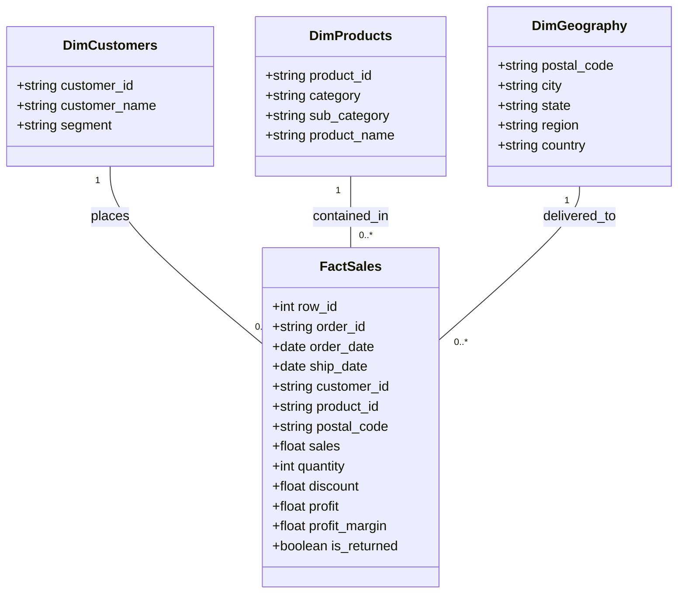

# Enterprise Data Dictionary

This document defines the schema, data types, business definitions, constraints, and lineage of all columns in the Enterprise Sales & Profit Intelligence Platform.

---

## 1. Cleaned Fact Table (`fact_sales`)

| Column Name | Physical Type | Logical Type | Nullable | Description / Business Logic | Example Values |
| :--- | :--- | :--- | :--- | :--- | :--- |
| `row_id` | `INTEGER` | Surrogate Key | No | Unique identifier for each line item within a transaction. | `1`, `42` |
| `order_id` | `VARCHAR` | Business Key | No | Standardized order identifier formatted as `[Country]-[Year]-[ID]`. Multiple rows share the same `order_id` for multi-item baskets. | `CA-2013-152156` |
| `order_date` | `DATE` | Temporal | No | Calendar date when the order was placed by the customer. | `2013-11-09` |
| `ship_date` | `DATE` | Temporal | No | Calendar date when the order was dispatched from fulfillment center. Verified: `ship_date >= order_date`. | `2013-11-12` |
| `ship_mode` | `VARCHAR` | Dimension | No | Service tier chosen for freight delivery. Values: `Standard Class`, `Second Class`, `First Class`, `Same Day`. | `Standard Class` |
| `customer_id` | `VARCHAR` | Foreign Key | No | Unique alphanumeric customer account identifier. | `CG-12520` |
| `customer_name` | `VARCHAR` | Dimension | No | Full legal/commercial name of customer contact. | `Claire Gute` |
| `segment` | `VARCHAR` | Dimension | No | Customer classification tier: `Consumer`, `Corporate`, `Home Office`. | `Consumer` |
| `country` | `VARCHAR` | Dimension | No | Operating sovereign nation. Fixed to `United States`. | `United States` |
| `city` | `VARCHAR` | Dimension | No | Municipality of destination address. | `Henderson`, `Seattle` |
| `state` | `VARCHAR` | Dimension | No | US State of delivery. | `Kentucky`, `California` |
| `postal_code` | `VARCHAR(5)`| Dimension | No | 5-digit US ZIP Code, formatted with leading zeros. | `42420`, `02138` |
| `region` | `VARCHAR` | Dimension | No | Geographic sales territory: `West`, `East`, `Central`, `South`. | `South` |
| `product_id` | `VARCHAR` | Foreign Key | No | Alphanumeric SKU identifier formatted as `[Category]-[SubCat]-[SKU]`. | `FUR-BO-10001798` |
| `category` | `VARCHAR` | Hierarchy L1 | No | High-level merchandise category: `Furniture`, `Office Supplies`, `Technology`. | `Furniture` |
| `sub_category` | `VARCHAR` | Hierarchy L2 | No | Detailed merchandise category (17 distinct values): `Chairs`, `Binders`, `Copiers`, etc. | `Bookcases` |
| `product_name` | `VARCHAR` | Dimension | No | Commercial catalog title of the product item. | `Bush Somerset Collection Bookcase` |
| `sales` | `DOUBLE` | Measure | No | Gross invoiced revenue in USD (after discount deduction). Range: `$0.44` to `$22,638.48`. | `261.96` |
| `quantity` | `INTEGER` | Measure | No | Physical unit count purchased. Must be an integer `>= 1`. Range: `1` to `14`. | `2` |
| `discount` | `DOUBLE` | Measure | No | Commercial discount percentage granted as a decimal fraction `[0.00, 0.80]`. | `0.00`, `0.20`, `0.80` |
| `profit` | `DOUBLE` | Measure | No | Net operating contribution profit in USD per line item (`sales - cost`). Can be negative. | `41.91`, `-3839.99` |
| `unit_price` | `DOUBLE` | Calculated | No | Implied gross revenue per unit: `ROUND(sales / quantity, 2)`. | `130.98` |
| `estimated_cost`| `DOUBLE` | Calculated | No | Operating cost of goods and fulfillment: `ROUND(sales - profit, 2)`. | `220.05` |
| `profit_margin` | `DOUBLE` | Calculated | No | Safe operating ratio: `CASE WHEN sales > 0 THEN profit / sales ELSE 0.0 END`. | `0.1600` |
| `discount_bracket`| `VARCHAR` | Calculated | No | Analytical tier: `0% (None)`, `1% - 10% (Low)`, `11% - 20% (Moderate)`, `21% - 40% (High)`, `> 40% (Deep Discount)`. | `0% (None)` |
| `shipping_days` | `INTEGER` | Calculated | No | Elapsed fulfillment duration: `ship_date - order_date`. | `3` |
| `is_returned` | `BOOLEAN` | Dimension | No | Boolean flag indicating whether the order was returned by customer (`True` / `False`). | `False` |

---

## 2. Dimensional Entity-Relationship Summary

