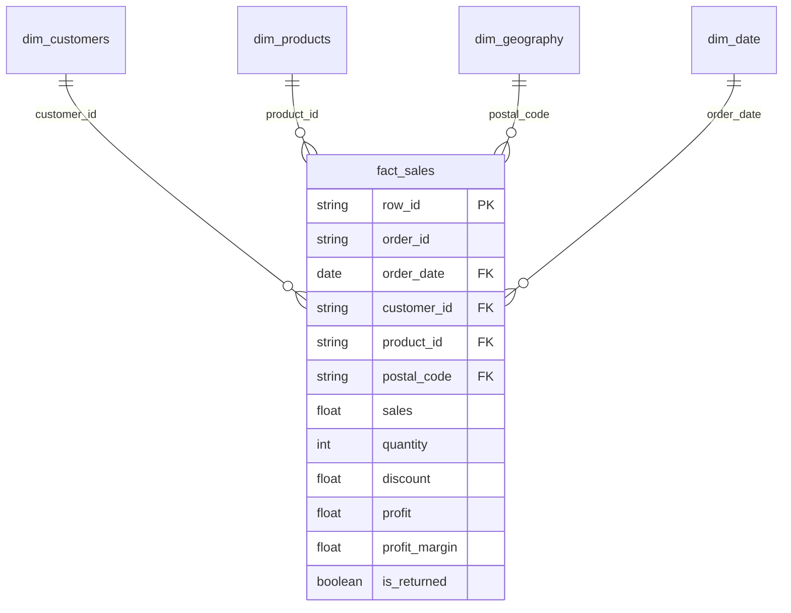

# Power BI Integration & Dimensional Modeling Guide

This guide provides instructions for loading the processed analytics dataset from DuckDB / Parquet into Microsoft Power BI Desktop, establishing a dimensional Star Schema, and configuring enterprise DAX measures.

---

## 1. Data Ingestion Architecture in Power BI

Power BI Desktop can ingest the clean data using two local-first methods:

### Option A: Direct Parquet Ingestion (Recommended for Speed)
1. Open **Power BI Desktop**.
2. Click **Get Data** > **More...** > **Parquet**.
3. Browse and select the processed dataset:
   ```
   data/processed/retail_sales_clean.parquet
   ```
4. Click **Transform Data** to open the Power Query Editor.

### Option B: DuckDB ODBC / Python Connector
If you have the DuckDB ODBC driver installed:
1. Select **Get Data** > **ODBC**.
2. Point the DSN to `database/sales_warehouse.duckdb`.
3. Ingest the pre-built dimensional views (`fact_sales`, `dim_customers`, `dim_products`, `dim_geography`, `mart_monthly_performance`).

---

## 2. Dimensional Star Schema Design

In Power BI **Model View**, establish one-to-many relationships (`1:*`) with single cross-filter direction:



---

## 3. Core Enterprise DAX Measures

Create a dedicated measures table `_Measures` and add the following DAX definitions (mirroring the SQL and Python logic exactly):

### Base Aggregations
```dax
Total Revenue = 
SUM(fact_sales[sales])

Total Profit = 
SUM(fact_sales[profit])

Total Units Sold = 
SUM(fact_sales[quantity])

Total Orders = 
DISTINCTCOUNT(fact_sales[order_id])

Total Customers = 
DISTINCTCOUNT(fact_sales[customer_id])
```

### Safe Profit Margin (Guarding Division by Zero)
```dax
Profit Margin % = 
DIVIDE([Total Profit], [Total Revenue], 0)
```

### Average Order Value (AOV) & Basket Size
```dax
Average Order Value = 
DIVIDE([Total Revenue], [Total Orders], 0)

Average Profit per Order = 
DIVIDE([Total Profit], [Total Orders], 0)

Units per Order = 
DIVIDE([Total Units Sold], [Total Orders], 0)
```

### Discount & Loss Forensic Measures
```dax
Average Discount % = 
AVERAGE(fact_sales[discount])

Total Losses Incurred = 
CALCULATE(
    SUM(fact_sales[profit]),
    fact_sales[profit] < 0
)

Unprofitable Line Items Count = 
CALCULATE(
    COUNTROWS(fact_sales),
    fact_sales[profit] < 0
)

Unprofitable Items % = 
DIVIDE([Unprofitable Line Items Count], COUNTROWS(fact_sales), 0)

Deep Discount Sales (>40%) = 
CALCULATE(
    [Total Revenue],
    fact_sales[discount] > 0.40
)
```

### Time Intelligence (Month-over-Month & Year-over-Year)
```dax
Sales Prior Month = 
CALCULATE([Total Revenue], DATEADD('dim_date'[Date], -1, MONTH))

MoM Revenue Growth % = 
DIVIDE([Total Revenue] - [Sales Prior Month], [Sales Prior Month], 0)

Sales Prior Year (Same Month) = 
CALCULATE([Total Revenue], SAMEPERIODLASTYEAR('dim_date'[Date]))

YoY Revenue Growth % = 
DIVIDE([Total Revenue] - [Sales Prior Year (Same Month)], [Sales Prior Year (Same Month)], 0)
```

---

## 4. Report Canvas Layout Guidelines

For an executive layout:
1. **Header Ribbon**: Slicers for `order_year`, `region`, `category`, and `discount_bracket`.
2. **Top Row**: 5 KPI Cards (`Total Revenue`, `Total Profit`, `Profit Margin %`, `Total Orders`, `Return Rate %`).
3. **Middle Section**:
   - Left: Line & Clustered Column Chart (X: `Year-Month`, Column: `Total Revenue`, Line: `Total Profit` and `Profit Margin %`).
   - Right: Horizontal Bar Chart (Category and Sub-Category ranked by `Total Profit`).
4. **Bottom Section**:
   - Left: Decomposition Tree analyzing `Total Profit` broken down by `Category` > `Discount Bracket` > `Region` > `Sub-Category`.
   - Right: Scatter Plot (X: `Average Discount %`, Y: `Profit Margin %`, Size: `Total Revenue`, Color: `Category`).
